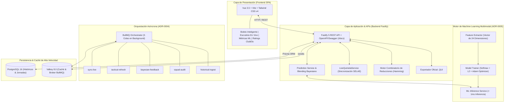

# QuantBet AI Platform ⚽🎯

[](https://opensource.org/licenses/MIT)
[](https://nodejs.org/)
[](https://fastify.dev/)
[](https://vuejs.org/)
[](https://tailwindcss.com/)
[](https://www.docker.com/)
[](tests/)

Plataforma cuantitativa, analítica y predictiva de alto rendimiento para **La Quiniela 1X2**, combinando un **motor de Machine Learning Ensemble Multimodal (24 variables)**, modelado probabilístico bivariado (**Dixon-Coles & Poisson**), auditoría táctica y de plantillas (**sistemas, referentes y bajas clave**), análisis espacial mediante **mapas de calor 3x3**, detección de ineficiencias de mercado (**Expected Value $EV$ frente a apuestas de SELAE**), y un motor combinatorio de reducciones con exportador oficial `.QUI`.

El proyecto es **100% autocontenido y reproducible**, listo para desplegarse mediante Docker Compose en cualquier entorno o ejecutarse en desarrollo local con recarga en caliente (*hot-reload*).

---

## 🏗️ Arquitectura del Sistema



---

## ✨ Características Principales

### 🧠 1. Motor de Machine Learning Ensemble Multimodal (ADR-0005)
Unifica en una única coctelera matemática un **vector continuo de 24 características normalizadas**:
* **Física de Goles (Dixon-Coles & Poisson)**: $\lambda$ local, $\mu$ visitante, probabilidad bivariada $P_1, P_X, P_2$ y corrección de empates a baja puntuación ($\tau$).
* **Unified Elo Bridge**: Ratings Elo dinámicos con **+65 puntos de ventaja de campo** y factores de liga UEFA.
* **Fatiga y Calendario Europeo**: Días de descanso entre partidos, impacto acumulativo y penalización de rendimiento.
* **Auditoría de Plantillas y Bajas**: Factores cuantitativos de degradación ofensiva y fragilidad defensiva por ausencias de jugadores clave.
* **Mapas de Calor Espaciales 3x3**: Altura media de línea defensiva, asimetría de flanco preferente vs debilidad rival y presión en último tercio.
* **Sesgo de Masa SELAE**: Detección de consenso de apostadores y cálculo de entropía de masa para cazar sorpresas y trampas de valor esperado ($EV$).
* **Validación Empírica**: **65.91% de acierto out-of-sample en validación cronológica ciega**, Brier Score de `0.4548` y Cross-Entropy Loss de `0.8694`.

### 👥 2. Auditoría de Plantillas y Referentes (ADR-0002)
* Detección de formaciones tácticas (4-3-3, 4-2-3-1, 3-5-2, etc.) y onces probables/confirmados.
* Algoritmo de **referentes de plantilla ponderados** por titularidad, peso ofensivo, dorsal y capitanía.
* Clasificación de bajas por gravedad (LEVE, MODERADA, CRÍTICA) y su impacto real en el xG del equipo.

### 🗺️ 3. Mapas de Calor Espaciales 3x3 (ADR-0003)
* Cuadrícula táctica 3x3 (Defensa, Medular, Ataque × Izquierda, Centro, Derecha).
* Identificación de puntos calientes (*hotspots*) y radar de choques de estilos de juego.

### ⚡ 4. Escrutinio y Seguimiento en Directo
* Pestaña dedicada **En Vivo & Escrutinio** con actualización en tiempo real de marcadores de partidos finalizados y en juego.
* Cálculo instantáneo de aciertos en el boleto del usuario y proyección de categorías de premios (15, 14, 13, 12, 11 y 10).

### ⚙️ 5. Orquestador de Tareas en Segundo Plano BullMQ (ADR-0004)
* 5 colas asíncronas sobre Valkey (`sync-live`, `tactical-refresh`, `bayesian-feedback`, `squad-audit`, `historical-ingest`).
* Telemetría de sólo lectura expuesta en `/api/queues/status` accesible tanto por API como por la interfaz.

### 📉 6. Reducciones Matemáticas y Exportador Oficial `.QUI`
* Algoritmo combinatorio Set-Cover con distancia de Hamming:
  * **Al 13**: Ahorro de hasta el 75% del coste de la apuesta manteniendo garantía oficial de 13 aciertos si entra el pronóstico base.
  * **Al 12 y Al 11**: Para presupuestos ajustados con coberturas de dobles y triples optimizadas.
* Generación directa del fichero estándar oficial `.QUI` para validación directa en ventanilla de Loterías y Apuestas del Estado o administraciones digitales.

---

## 🛠️ Stack Tecnológico

| Capa | Tecnologías | Propósito |
| :--- | :--- | :--- |
| **Frontend** | Vue 3.5, Vite 6, Tailwind CSS v4, Lucide Icons | Interfaz Dark Glassmorphism, dock flotante y paneles analíticos reactivos |
| **Backend API** | Node.js 22 LTS, TypeScript, Fastify 5, Zod | Endpoints REST de alto rendimiento (>70k req/s), validación de esquemas y documentación OpenAPI |
| **Persistencia** | PostgreSQL 16 Alpine con Prisma ORM | Almacenamiento relacional de históricos, temporadas, jornadas, partidos y cuotas |
| **Caché & Colas** | Valkey 8.0 Alpine & BullMQ | Caché de baja latencia en memoria y gestión de tareas asíncronas |
| **ML & Matemáticas** | TypeScript puro en Node.js | Optimizador Adam, blenders bayesianos, Dixon-Coles y matrices de marcadores |
| **Orquestación** | Docker Compose | Despliegue reproducible con volumen persistente y red bridge aislada |

---

## 🚀 Despliegue con Docker Compose (Recomendado)

Levanta la plataforma completa (Frontend, Backend, PostgreSQL y Valkey) con un solo comando:

```bash
# 1. Clonar el repositorio
git clone https://github.com/jmblanco/quantbet-ai.git
cd quantbet-ai

# 2. Levantar los contenedores
docker compose up -d --build
```

Una vez iniciados los servicios:
* **Aplicación Web**: [http://localhost:8080](http://localhost:8080)
* **Documentación Interactiva Swagger / OpenAPI**: [http://localhost:8080/docs](http://localhost:8080/docs)
* **Healthcheck de Diagnóstico**: [http://localhost:8080/api/health](http://localhost:8080/api/health)
* **Estado de Colas Asíncronas**: [http://localhost:8080/api/queues/status](http://localhost:8080/api/queues/status)
* **Estado del Modelo ML**: [http://localhost:8080/api/ml/model-status](http://localhost:8080/api/ml/model-status)

Para detener la infraestructura:
```bash
docker compose down
```

---

## 💻 Entorno de Desarrollo Local

Si deseas desarrollar con recarga en caliente (*hot-reload*):

### 1. Iniciar Base de Datos y Caché
```bash
docker compose up -d postgres valkey
```

### 2. Backend (Fastify & TypeScript)
```bash
cd services/backend
npm install
npm test            # Ejecuta los 40 tests unitarios con Vitest (100% pasando)
npm run seed        # Inicializa la base de datos con jornadas históricas y actuales
npm run dev         # Inicia la API en http://localhost:3333
```

### 3. Frontend (Vue 3 & Vite)
```bash
cd services/frontend
npm install
npm run dev         # Inicia la SPA en http://localhost:5173
```

---

## 📡 Catálogo Principal de Endpoints API

| Método | Endpoint | Descripción |
| :---: | :--- | :--- |
| `GET` | `/api/health` | Estado de salud del backend, conexión de PostgreSQL y Valkey. |
| `GET` | `/api/jornadas/actual` | Devuelve la jornada activa con partidos, predicciones ML, plantillas y mapas tácticos. |
| `GET` | `/api/jornadas` | Listado histórico de jornadas disponibles. |
| `GET` | `/api/jornadas/:id` | Detalle completo de una jornada específica. |
| `POST` | `/api/jornadas/sync-live` | Fuerza la sincronización en vivo con fuentes oficiales SELAE. |
| `GET` | `/api/ml/model-status` | Telemetría del modelo ML: precisión en validación, Brier score, loss y pesos de features. |
| `POST` | `/api/ml/train` | Dispara el reentrenamiento en caliente del ensemble multimodal sobre el histórico real. |
| `GET` | `/api/metricas` | Resumen analítico global: ROI, distribución de signos, eficiencia de reducción y estado del ML. |
| `GET` | `/api/modelo/ratings` | Tabla de ratings Elo actualizados para los 20 clubes de LaLiga. |
| `POST` | `/api/modelo/retroalimentar` | Ejecuta la retroalimentación bayesiana tras resolución de jornada. |
| `POST` | `/api/reducciones/calcular` | Calcula el conjunto mínimo de boletos para reducciones oficiales al 13, 12 u 11. |
| `GET` | `/api/queues/status` | Monitorización en tiempo real de las 5 colas BullMQ en Valkey. |

---

## 📚 Registro de Decisiones de Arquitectura (ADRs)

Todas las decisiones estructurales y elecciones técnicas se encuentran documentadas en [`docs/decisions/`](docs/decisions/):

- **[ADR-0001: Selección del Stack Tecnológico, Persistencia y Capa de ML](docs/decisions/ADR-0001-stack-tecnologico-quiniela.md)**
- **[ADR-0002: Modelado de Alineaciones, Convocatorias y Estado de Jugadores](docs/decisions/ADR-0002-modelado-alineaciones-estado-jugadores.md)**
- **[ADR-0003: Integración de Mapas de Calor Tácticos Dinámicos](docs/decisions/ADR-0003-mapas-calor-dinamicos-semanales.md)**
- **[ADR-0004: Orquestación de Tareas Asíncronas en Background con BullMQ y Valkey](docs/decisions/ADR-0004-orquestacion-tareas-bullmq-valkey.md)**
- **[ADR-0005: Motor de Entrenamiento Supervisado de Machine Learning Multimodal](docs/decisions/ADR-0005-motor-entrenamiento-ml-multimodal.md)**

---

## 🧪 Calidad de Código y Tests

La plataforma cuenta con una suite completa de **40 tests unitarios** implementados con Vitest:
* `tests/ml-ensemble.test.ts`: Validación de extracción de 24 features, inferencia blending, convergencia del optimizador Adam y entrenamiento supervisado.
* `tests/poisson-dixon-coles.test.ts`: Matrices de probabilidad bivariada, parámetro tau y marcadores exactos de Pleno al 15.
* `tests/reduction-engine.test.ts`: Cobertura de matrices de reducción al 13, 12 y 11 con distancias de Hamming.
* `tests/qui-generator.test.ts`: Formato y sintaxis conforme al estándar oficial `.QUI` de SELAE.
* `tests/fatigue.test.ts`: Coeficientes de fatiga por calendario europeo y rotación.
* `tests/bayesian-feedback.test.ts`: Convergencia bayesiana de pesos.
* `tests/metrics.test.ts`: Endpoints analíticos y serialización de KPIs.

Para ejecutar la suite:
```bash
cd services/backend && npm test
```

---

## 📄 Licencia

Este proyecto está distribuido bajo la licencia [MIT](LICENSE).
