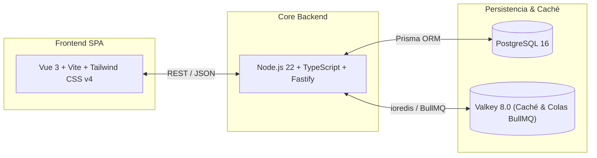

# ADR-0001: Selección del Stack Tecnológico, Persistencia y Capa de ML (MVP La Quiniela)

- **Estado**: Accepted
- **Fecha**: 2026-10-24
- **Decisores**: Arquitecto de Software & Usuario
- **Ámbito**: Sistema de Predicción de La Quiniela (MVP) con escalabilidad para juegos numéricos

---

## 1. Contexto y Problema

Se requiere construir el MVP de una plataforma analítica y predictiva centrada en **La Quiniela** (con previsión de incorporar sorteos numéricos como Bonoloto/Primitiva a posteriori). El sistema debe:
1. Ingerir y almacenar históricos de partidos, cuotas de mercado y porcentajes de recaudación de SELAE.
2. Ejecutar modelos probabilísticos (Dixon-Coles, Poisson, regresiones) y cálculo de valor esperado ($EV$).
3. Generar combinaciones reducidas y condicionadas en tiempo interactivo para el usuario.
4. Proveer un frontend ágil, reactivo y de fácil mantenimiento.

El usuario manifiesta alta comodidad con **Node.js** (o Java con **Quarkus**), preferencia por la alternativa open-source **Valkey** (fork comunitario de Redis), cuestiona la necesidad real de **TimescaleDB** y evalúa **Vue** vs **React**.

---

## 2. Decisión

Se adopta una **arquitectura desacoplada de alto rendimiento basada en Node.js + TypeScript y Vue 3**:

### Componentes seleccionados:
1. **Core Backend**: **Node.js 22 con TypeScript y Fastify**.
   - Gestiona endpoints REST, motor de reducciones combinatorias (altamente eficiente en el motor V8), inferencia probabilística y sincronización en tiempo real.
2. **Capa de Modelado e Inferencia ML**: **Nativa en TypeScript**.
   - Implementación pura en Node.js de Dixon-Coles, optimizador Adam, blenders bayesianos y clasificador multivariado sin sobrecostes operacionales externos.
3. **Persistencia**: **PostgreSQL 16 estándar (sin TimescaleDB)**.
4. **Caché y Colas**: **Valkey 8.0** (drop-in replacement de código abierto bajo licencia BSD-3-Clause).
5. **Frontend**: **Vue 3 con Vite y Tailwind CSS v4** (Single Page Application moderna, tipada y reactiva).

---

## 3. Justificación y Análisis de Alternativas

### 3.1. Persistencia: ¿Por qué PostgreSQL estándar y no TimescaleDB?
- **Volumen de datos real**:
  - La Quiniela celebra entre 55 y 65 jornadas al año.
  - Con 15 partidos por jornada = **~900 partidos al año**.
  - En 30 años de histórico acumulado, la tabla principal tendrá apenas **~27.000 filas**.
- **Evaluación**:
  - TimescaleDB está diseñado para ingesta masiva de millones de eventos por segundo (IoT, métricas financieras de microsegundos).
  - Para ~27.000 filas, un índice B-Tree estándar de PostgreSQL sobre `(temporada, jornada, fecha)` resuelve las consultas en **sub-milisegundos (< 1 ms)**.
  - Introducir TimescaleDB añadiría complejidad operacional, dependencias de extensiones propietarias y sin beneficio de rendimiento apreciable.

### 3.2. Caché y Broker: Valkey frente a Redis
- Tras el cambio de licencia de Redis en 2024 (a licencias restrictivas RSALv2/SSPL), la Linux Foundation, AWS, Google y Cloudflare impulsaron **Valkey**.
- Valkey es 100% compatible con los clientes de Node.js (`ioredis`, `bullmq`) y garantiza soberanía de código abierto libre. Se adopta de forma nativa.

### 3.3. Core Backend: Fastify (Node.js) frente a Express / NestJS / Python
- Fastify ofrece el rendimiento más elevado de la comunidad Node.js (> 70.000 req/s), bajo overhead de memoria, serialización JSON optimizada con esquema y compatibilidad directa con TypeScript y Vitest.

### 3.4. Frontend: Vue 3 + Tailwind CSS
- Reactividad nativa con Composition API (`<script setup>`), menor sobrecarga de re-renderizado que React y excelente rendimiento para interfaces analíticas complejas con docks flotantes y cálculo combinatorio interactivo.

---

## 4. Consecuencias y Trade-offs

### Consecuencias Positivas:
- **Agilidad y Cohesión**: Un único ecosistema TypeScript tipado de extremo a extremo.
- **Portabilidad**: Contenedores Docker ligeros basados en Alpine Linux.
- **Cero Deuda Técnica de Licencias**: PostgreSQL y Valkey garantizan software libre puro.
