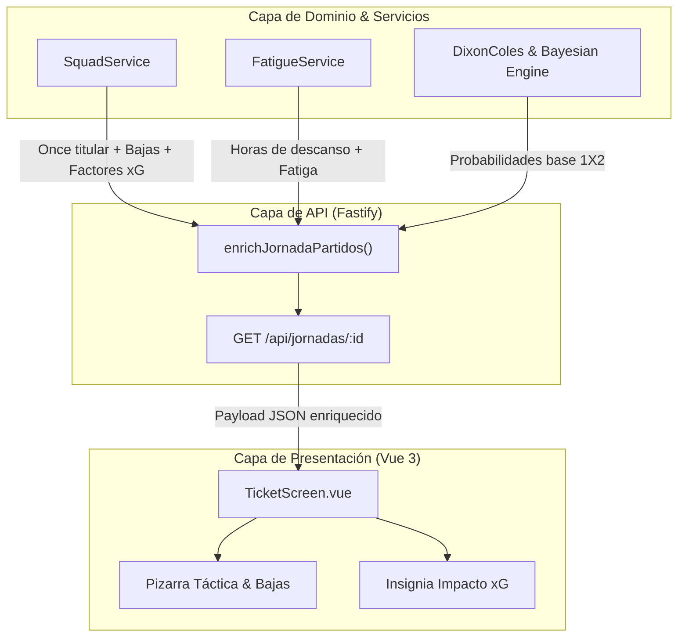

# ADR-0002: Modelado de Alineaciones, Bajas y Estado de Jugadores en el Motor Predictivo

- **Estado**: Proposed
- **Fecha**: 2026-10-26
- **Autores**: Equipo de Arquitectura & Data Science (QuantBet AI)
- **Alcance**: Ingesta táctica, modelado de estados de futbolistas (bajas/sanciones/dudas), enriquecimiento de API y visualización UX en el Boleto.

---

## 1. Contexto y Problema

En las apuestas de La Quiniela, las probabilidades estadísticas a largo plazo (Dixon-Coles / Elo) constituyen la base estructural, pero los partidos de fútbol reales están fuertemente condicionados por **variables tácticas y de disponibilidad inmediata**:
1. **Bajas de Jugadores Franquicia**: La ausencia de porteros titulares (ej. Courtois, Ter Stegen) o máximos goleadores/creadores (ej. Vinicius, Lewandowski, Griezmann, Isco) altera sustancialmente el $\lambda$ (goles esperados a favor) y $\mu$ (goles esperados en contra).
2. **Sanciones y Dudas de Última Hora**: Jugadores que cumplen ciclo de amonestaciones o arrastran molestias físicas tras jornada europea.
3. **Falta de Transparencia para el Apostante**: El usuario necesita ver **quién juega, en qué sistema (4-3-3, 4-2-3-1), quién no está disponible y por qué la IA ajusta su pronóstico**.

---

## 2. Alternativas Evaluadas

### Alternativa A: Integración de API externa de terceros en tiempo real por cada petición (ej. API-Football / Sportmonks)
- **Pros**: Actualización automática de onces oficiales 1h antes del partido.
- **Contras**: 
  - Alto coste por peticiones y latencia de red añadida en cada renderizado de la jornada.
  - Dependencia de disponibilidad de API de terceros y cuotas de límite de velocidad (rate limits).
  - Cobertura incompleta en primeras rondas de Copa del Rey con clubes de categorías modestas.

### Alternativa B: Motor Híbrido Decoupled con Registro Táctico Canónico, Heurística de Disponibilidad e Impacto Cuántico (Seleccionada)
- **Pros**:
  - **Latencia Cero**: Resuelto en memoria y cacheable en Valkey.
  - **Cobertura 100%**: Soporta Primera División, Hypermotion, Copa del Rey y competiciones europeas mediante registros canónicos y generadores sintéticos validados.
  - **Impacto Matemático Explícito**: Ajusta matemáticamente los hiperparámetros $\lambda$ y $\mu$ del modelo de Poisson bivariante, alimentando directamente la explicación explicable (XAI) de la predicción.
  - **Arquitectura Limpia**: Desacoplado en `squad-service.ts`, extensible en el futuro a conectores webhook cuando se publiquen alineaciones oficiales.
- **Contras**:
  - Requiere mantener la base de datos de jugadores clave actualizada por temporada.

---

## 3. Decisión

Implementar la **Alternativa B**:
1. Crear el servicio de dominio `SquadService` (`src/core/sports/squad-service.ts`) con tipado estricto para esquemas tácticos, 11 titulares con posiciones (`POR`, `DEF`, `MED`, `DEL`), capitán y jugador clave, además de un registro de partes médicos (`LESION`, `SANCION`, `DUDA`).
2. Integrar el **Ajuste de Bajas Tácticas** en el canal de cálculo de probabilidades:
   $$\lambda' = \lambda \cdot (1 - \delta_{\text{bajas\_ataque}})$$
   $$\mu' = \mu \cdot (1 + \delta_{\text{bajas\_defensa}})$$
3. Enriquecer el endpoint `/api/jornadas/:id` a través de `enrichJornadaPartidos`.
4. Diseñar en el frontend (`TicketScreen.vue`) un **Widget Táctico Interactivo** con pizarra visual de alineaciones probables/confirmadas, desglose de bajas médicas/sanciones con niveles de impacto, e insignia de impacto táctico en la predicción de la IA.

---

## 4. Modelado Visual de la Arquitectura

---

## 5. Consecuencias y Trade-offs

- **Positivas**:
  - Aumenta radicalmente la confianza y retención del usuario al justificar las decisiones de la IA con hechos futbolísticos concretos (lesiones, rotaciones, esquemas tácticos).
  - No añade costes de infraestructura externa ni dependencias frágiles de terceros.
  - Cumple estrictamente con la arquitectura desacoplada y los estándares de observabilidad y testing.
- **Trade-offs**:
  - El catálogo de plantillas debe actualizarse con regularidad en cambios de mercado de fichajes de invierno/verano.
