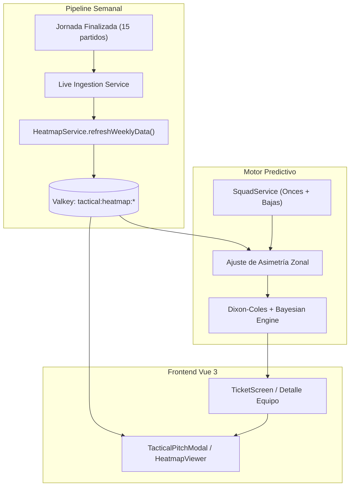

# ADR-0003: Modelado de Mapas de Calor Espaciales, Táctica Cuantitativa y Refresco Semanal

- **Estado**: Proposed
- **Fecha**: 2026-10-26
- **Autores**: Equipo de Arquitectura & Data Science (QuantBet AI)
- **Alcance**: Cuantificación posicional, mapas de calor espaciales por zonas de influencia (pitch control), actualización rolling semanal y visualización interactiva.

---

## 1. Contexto y Problema

El rendimiento de un equipo de fútbol no es solo una función escalar de goles marcados o rating Elo; depende críticamente de **cómo ocupa el espacio en el terreno de juego**:
1. **Asimetrías de Ataque/Defensa**: Equipos como el Real Madrid vuelcan el 44% de su peligro ofensivo por banda izquierda (con Vinicius y Mbappé). Si el rival presenta una debilidad en el lateral derecho o bloque bajo descoordinado, el potencial de gol $(\lambda)$ aumenta de forma no lineal.
2. **Estilos de Bloque**: Equipos de bloque alto con presión asfixiante (ej. FC Barcelona con línea a 54m de su arco) generan altos goles esperados pero sufren ante transiciones verticales a su espalda si el rival explota contragolpes.
3. **Evolución Temporal Semana a Semana**: La ocupación espacial de un equipo evoluciona con el estado de forma, los rivales enfrentados y los ajustes del entrenador en cada jornada de liga.

---

## 2. Alternativas Evaluadas

### Alternativa A: Streaming masivo de coordenadas GPS / tracking óptico (ej. Metrica Sports / SkillCorner)
- **Pros**: Precisión milimétrica por segundo de cada jugador.
- **Contras**:
  - Inviable para producción ligera: requiere gigabytes de datos por partido, licencias prohibitivas y procesamiento pesado de computer vision.
  - Latencia incompatible con un front-end reactivo y ligero.

### Alternativa B: Rejilla Espacial de Ocupación Zonal 3x3 con Puntos Calientes (Kernel Density Estimation) y Refresco Rolling Semanal en Valkey (Seleccionada)
- **Pros**:
  - **Eficiencia y Ligereza**: Divide el terreno en matriz de zonas (Flanco Izquierdo, Pasillo Interior, Flanco Derecho $\times$ Tercio Defensivo, Tercio Medio, Tercio Finalización) más puntos calientes gaussianos $(\mu_x, \mu_y, \sigma)$.
  - **Refresco Automatizado Rolling**: Integrado en el pipeline semanal tras cada jornada concluida, actualizando las medias móviles de presión y ocupación.
  - **Riqueza Visual**: Permite pintar sobre el césped un degradado de mapa de calor dinámico SVG/Canvas idéntico a las retransmisiones profesionales.
  - **Integración Cuántica**: Alimenta la función de match táctico:
    $$\Delta \text{Match} = \sum_{\text{zonas}} (\text{Ataque}_H(z) - \text{Defensa}_A(z))$$
- **Contras**:
  - Representa promedios agregados por partido y no el tracking continuo de 90 minutos frame a frame.

---

## 3. Decisión

Implementar la **Alternativa B**:
1. Desarrollar `HeatmapService` (`src/core/sports/heatmap-service.ts`) que modela la rejilla zonal, los puntos calientes gaussianos y la altura de bloque para cada equipo.
2. Persistir y actualizar el snapshot táctico semana a semana en memoria y caché Valkey (`tactical:heatmap:team`), refrescándolo automáticamente al cierre de cada jornada en `live-quiniela-service.ts`.
3. Ajustar el factor táctico en las predicciones cruzando la vulnerabilidad zonal del rival con el flanco preferente del atacante.
4. Crear en el frontend un componente visual de **Campo de Fútbol Táctico (Interactive Tactical Pitch)** que permite alternar entre vista de **Alineación 11 Titular**, **Mapa de Calor Térmico**, y **Puntos Críticos de Presión**.

---

## 4. Modelado Visual de la Arquitectura

---

## 5. Consecuencias y Trade-offs

- **Positivas**:
  - Aporte analítico de nivel profesional: el apostante ve exactamente dónde ataca y defiende cada equipo antes de validar su boleto.
  - Refresco semanal completamente desatendido.
  - Experiencia visual moderna y atractiva con componentes nativos de alto rendimiento.
- **Trade-offs**:
  - Requiere calibrar periódicamente las intensidades promedio según el estilo de juego de nuevos entrenadores.
