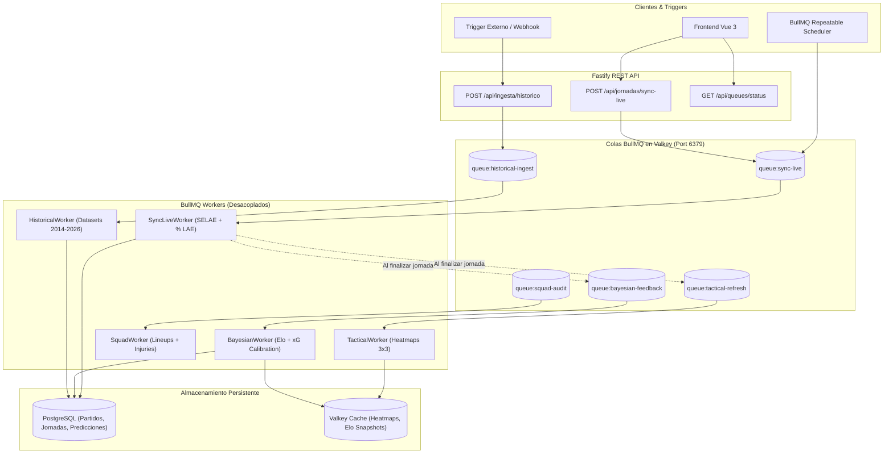

# ADR-0004: Orquestación Asíncrona de Tareas y Colas de Ingesta con BullMQ y Valkey

- **Estado**: Proposed
- **Fecha**: 2026-10-26
- **Autores**: Equipo de Arquitectura & Data Platform (QuantBet AI)
- **Alcance**: Orquestación de procesos en segundo plano, colas de ingesta en vivo, refresco táctico semanal, retroalimentación bayesiana, auditoría de plantillas e ingesta histórica.

---

## 1. Contexto y Problema

Hasta ahora, las operaciones de actualización de datos en QuantBet AI se realizaban de forma síncrona dentro del ciclo de solicitud-respuesta HTTP de Fastify o como llamadas flotantes `Promise.then()` no supervisadas:
1. **Riesgo de Timeout y Bloqueo de Event Loop**: Tareas pesadas como el re-cálculo bayesiano de ratings de toda la temporada o la ingesta histórica de miles de partidos bloquean recursos y aumentan los tiempos de respuesta del cliente.
2. **Falta de Trazabilidad y Reintentos Automáticos**: Si una llamada a una fuente externa (ej. escrutinio SELAE) sufre un error de red o rate limit, no existía mecanismo de reintento exponencial (*exponential backoff*), provocando pérdida de sincronización.
3. **Imposibilidad de Programar Cadencias Mixtas**: Durante los fines de semana de partidos se requiere un refresco cada 60 segundos, mientras que entre semana se necesitan auditorías de bajas cada 6 horas y el post-procesado táctico solo al concluir el boleto.
4. **Infraestructura Existente Infrautilizada**: Valkey (Redis-compatible) ya se encuentra activo en el puerto 6379, pero solo se utilizaba para almacenamiento clave-valor pasivo.

---

## 2. Alternativas Evaluadas

### Alternativa A: Temporizadores nativos `setInterval` y `node-cron` en el proceso principal
- **Pros**: Cero dependencias adicionales, implementación trivial.
- **Contras**:
  - Acopla fuertemente el ciclo de vida del servidor web con los trabajos en background.
  - Imposibilidad de monitorizar colas, pausar trabajos o distribuir carga entre múltiples workers o réplicas sin ejecutar jobs duplicados.
  - No persiste el estado de los jobs: un reinicio del backend pierde la cola en memoria.

### Alternativa B: Mensajería pesada dedicada (RabbitMQ / Apache Kafka + Celery)
- **Pros**: Estándar de la industria para streaming masivo de eventos y arquitecturas de microservicios a escala de millones de mensajes por segundo.
- **Contras**:
  - Complejidad operativa excesiva para el volumen actual.
  - Requiere nuevos contenedores dedicados, mayor consumo de memoria y configuración de brokers adicionales.

### Alternativa C: Orquestador Distribuido BullMQ sobre Valkey con Colas Temáticas Desacopladas (Seleccionada)
- **Pros**:
  - **Aprovechamiento de Infraestructura**: Corre de forma nativa sobre Valkey (Redis 7+ compatible) ya activo sin añadir infraestructura externa.
  - **Colas Temáticas Aisladas**: Permite asignar una cola independiente para cada flujo:
    * `queue:sync-live`: Marcadores y % LAE en directo (repetible cada 60s en juego o bajo demanda).
    * `queue:tactical-refresh`: Cálculo semanal de mapas de calor 3x3 y perfiles espaciales.
    * `queue:bayesian-feedback`: Calibración de ratings Elo y parámetros $\lambda/\mu$.
    * `queue:squad-audit`: Auditoría de onces y bajas médicas 24h y 1h antes del cierre.
    * `queue:historical-ingest`: Ingesta pesada de datasets sin penalizar la API REST.
  - **Robustez y Observabilidad**: Manejo automático de concurrencia, reintentos exponenciales, eventos de progreso (`completed`, `failed`) y APIs de inspección.
- **Contras**:
  - Requiere gestionar conexiones Redis con `maxRetriesPerRequest: null`.

---

## 3. Decisión

Implementar la **Alternativa C**:
1. Crear el módulo de infraestructura [`queue-manager.ts`](file:///C:/Users/Jose%20Miguel/Desktop/Chemy/Proyectos/quiniela-ia-platform/services/backend/src/infrastructure/queue-manager.ts) que inicializa las 5 colas en BullMQ y define sus workers con backoff exponencial.
2. Migrar la sincronización manual de `POST /api/jornadas/sync-live` y de la ingesta histórica para que encolen jobs en BullMQ y respondan con el `jobId` de inmediato.
3. Exponer endpoints de observabilidad de colas:
   - `GET /api/queues/status`: Muestra el número de jobs activos, en espera, completados y fallidos por cola.
   - `POST /api/queues/:name/dispatch`: Permite disparar un job bajo demanda en cualquiera de las colas.
   - `POST /api/queues/:name/pause` y `resume`: Control operacional de ejecución.
4. Configurar la tarea programada repetible (*repeatable job*) en `queue:sync-live` que verifica periódicamente si la jornada está `EN_JUEGO` para acelerar el escrutinio.

---

## 4. Modelado Visual de la Arquitectura

---

## 5. Consecuencias

### Positivas
- **Desacoplamiento Total**: Las peticiones de usuario responden en milisegundos (`202 Accepted`), sin retener sockets abiertos durante scrapings o cálculos pesados.
- **Resiliencia Operacional**: Errores transitorios de red se reintentan automáticamente con backoff exponencial (3 intentos: 1s, 2s, 4s).
- **Trazabilidad y Métricas**: Cada job posee estado, duración, porcentaje de progreso e historial de fallos accesible desde `/api/queues/status`.

### Negativas / Trade-offs
- Requiere monitorizar el uso de memoria en Valkey cuando el histórico de jobs completados crece (mitigado mediante retención automática `removeOnComplete: { count: 100 }`).
