# ADR-0005: Motor de Entrenamiento ML Multimodal (Ensemble Táctico-Espacial, Dixon-Coles, Elo, Fatiga y Sesgo LAE)

- **Estado**: proposed
- **Fecha**: 2026-10-27
- **Autores**: Equipo de Arquitectura & Data Science (QuantBet AI)
- **Alcance**: Extracción de features multimodales, tubería de entrenamiento de Machine Learning, evaluación offline/online, calibración probabilística e inferencia en tiempo real para La Quiniela 1X2.

---

## 1. Contexto y Problema

Hasta la fecha, la plataforma QuantBet AI ha ido incorporando múltiples fuentes ricas de información cualitativa y cuantitativa:
1. **Dixon-Coles & Poisson**: Estimación de tasas base de gol ($\lambda, \mu$) y correlación bivariada de marcadores bajos ($\rho$).
2. **Ratings Elo Multi-División**: Fuerza competitiva relativa con ajuste de localía (+65 puntos) y penalización de categoría (Primera, Segunda, Copa del Rey).
3. **Fatiga & Calendario Europeo**: Días de descanso, acumulación de minutos e impacto de Champions/Europa/Conference League.
4. **Plantillas & Bajas Clave**: Factores ofensivos y defensivos derivados del estado físico de titulares y referentes.
5. **Mapas de Calor Espaciales & Táctica 3x3**: Desequilibrios zonales por bandas, altura de la zaga en metros y porcentaje de presión.
6. **Sesgo de Masa SELAE**: Distribución del dinero apostado por el público general y Expected Value ($EV$).

Sin embargo, estos componentes interactuaban hasta ahora mediante **reglas heurísticas desacopladas** (multiplicadores lineales del 4% en $\lambda$ o sumas fijas). Para maximizar el retorno de inversión y la precisión predictiva, es necesario **unificar todas las variables en un vector de características (feature vector) y entrenar un modelo de Machine Learning supervisado** que aprenda las interacciones no lineales sobre las más de 460 jornadas históricas almacenadas en PostgreSQL.

---

## 2. Alternativas Evaluadas

### Alternativa A: Microservicio Externo en Python (FastAPI + XGBoost / PyTorch)
- **Pros**: Acceso al ecosistema clásico de Data Science de Python (`xgboost`, `scikit-learn`, `optuna`).
- **Contras**:
  - Introduce una dependencia de runtime pesada adicional (Python 3.12, virtualenv, dependencias C/CUDA).
  - Requiere un nuevo contenedor Docker o proceso demonio persistente, sumando latencia de red IPC/HTTP en cada cálculo de jornada.
  - Mayor fragilidad de despliegue y mantenimiento en entornos CI/CD.

### Alternativa B: Motor de Machine Learning Nativo en TypeScript con Ensemble Multicapa Calibrado (Seleccionada)
- **Pros**:
  - **Cero Dependencias Externas**: Ejecución 100% nativa en el proceso de Node.js/Fastify con inferencia en sub-milisegundos ($< 1$ ms por partido).
  - **Ensemble Híbrido**: Combina un clasificador multiclase (Softmax Regularizado L2 / Gradient Boosting por descenso de gradiente) con el prior físico de Dixon-Coles mediante ponderación adaptativa bayesiana.
  - **Vector de 24 Features Cuantitativas**: Integra espaciales, Dixon-Coles, Elo, fatiga, bajas y sesgo de masa.
  - **Serialización Inmutable en JSON & Caché Valkey**: El modelo entrenado guarda su vector de pesos, medias, desviaciones típicas e importancias de features de forma auditable.
  - **Totalmente Testeable**: Pruebas unitarias de convergencia, descenso de gradiente y calibración en Vitest sin librerías binarias nativas.
- **Contras**:
  - Los algoritmos de optimización (descenso de gradiente estocástico mini-batch, regularización Ridge/L2) deben ser implementados de forma limpia y mantenible en código fuente TypeScript.

---

## 3. Decisión

Implementar la **Alternativa B**:
1. Crear el módulo `src/core/ml/` en el backend con los siguientes componentes:
   - `feature-extractor.ts`: Transforma los datos de cualquier partido (histórico o futuro) en un vector normalizado de 24 características (Z-Score scaling).
   - `model-trainer.ts`: Entrena un clasificador ensemble multiclase minimizando la entropía cruzada (Cross-Entropy Log-Loss) con regularización L2 y parada temprana (*early stopping*).
   - `ml-inference-service.ts`: Realiza la inferencia en tiempo real y el blending con Dixon-Coles.
2. Integrar el modelo en `PredictionService` para que las recomendaciones de signos (`1`, `X`, `2`) y los scores de confianza incorporen las ponderaciones del modelo ML entrenado.
3. Exponer el estado del modelo, métricas de precisión y pesos de importancia de variables (*feature importance*) en la API y en el panel de control frontend.

---

## 4. Modelado Visual de la Arquitectura

```mermaid
flowchart TD
    subgraph INGESTION ["1. Ingesta de Señales Multimodales"]
        DC["Dixon-Coles & Poisson<br/>(&lambda;, &mu;, P1, PX, P2)"]
        ELO["Elo Multi-League<br/>(Local, Away, &Delta;Elo)"]
        FAT["Fatiga Europea<br/>(Descanso, Carga)"]
        SQD["Bajas & Plantillas<br/>(Factor Of/Def, Claves)"]
        HMP["Mapas Espaciales 3x3<br/>(Banda, Altura, Presión)"]
        LAE["Sesgo de Masa SELAE<br/>(% Apostado, EV)"]
    end

    subgraph PIPELINE ["2. Pipeline de Machine Learning (src/core/ml)"]
        FE["Feature Extractor<br/>(24 Features Normalizadas)"]
        SPLIT["Split Cronológico 80/20<br/>(Train / Validation Set)"]
        TRAIN["Optimizer: Mini-Batch SGD<br/>+ Cross-Entropy Loss + L2 Reg"]
        MODEL["Modelo Serializado JSON<br/>(Pesos & Z-Scores en Valkey)"]
    end

    subgraph INFERENCE ["3. Inferencia & Escrutinio"]
        INF["ML Inference Engine"]
        BLEND["Ensemble Bayesian Blending<br/>w_ML &middot; P_ML + (1-w_ML) &middot; P_DC"]
        API["Fastify API Routes<br/>(/api/jornadas & /api/metricas)"]
        UI["Frontend UI<br/>(Boleto, Escrutinio & Métricas)"]
    end

    DC --> FE
    ELO --> FE
    FAT --> FE
    SQD --> FE
    HMP --> FE
    LAE --> FE

    FE --> SPLIT
    SPLIT --> TRAIN
    TRAIN --> MODEL
    MODEL --> INF

    INF --> BLEND
    DC --> BLEND
    BLEND --> API
    API --> UI
```

---

## 5. Consecuencias y Trade-offs

- **Positivas**:
  - Salto cuantitativo: el sistema deja de usar ajustes manuales ad-hoc y pasa a basar sus probabilidades en un modelo entrenado sobre más de una década de fútbol profesional español.
  - Explicabilidad: el modelo devuelve la importancia relativa de cada variable (ej. cuánto pesa el choque de bandas frente al Elo).
  - Máxima velocidad de ejecución sin dependencias de Python ni procesos de red extra.
- **Negativas**:
  - Mayor volumen de cálculo durante la fase de entrenamiento offline (compensado con ejecución asíncrona o bajo demanda con streaming de logs).
- **Follow-ups**:
  - Diseñar tests unitarios específicos para verificar la no-degeneración de probabilidades ($\sum P_i = 1$) y la convergencia del loss.
